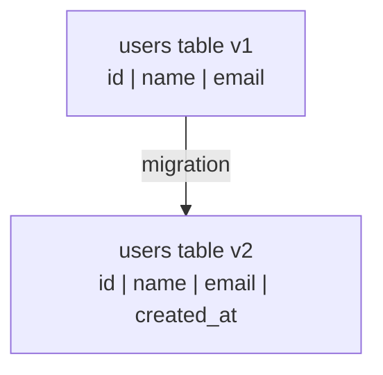
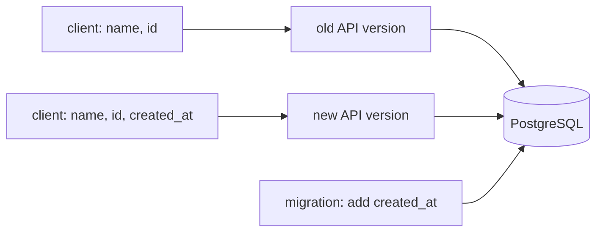

# Session 10: schema changes are versioned, ordered, and applied once

**Continues:** [Session 9](session-9.md)

## The question we set out to answer

Session 9 ended with two API instances sharing one PostgreSQL database. That moves the problem from
capacity to change safety. A real database holds durable data, so **the database schema now lives
longer than any one application process.** Containers are replaced; the `users` table is not.

> **If I add a new field to the Python model, does an existing PostgreSQL database magically know
> that I changed my code?**

No. Application code and database schema are separate things. A **schema** is the structural
definition of the database, the shape of the data: tables, columns, types, constraints. Changing
the code changes nothing in Postgres. We need an explicit way to move the schema from version A to
version B.

## A migration is a versioned, ordered schema change



<!-- whiteboard: diagrams/session10-schema-v1-to-v2.png (drawn with `age` as the new column) -->

The important word is **versioned**. We want to know which change happened, in what order, and
whether a given database has already had it applied.

Before this session the API created its table on startup with `CREATE TABLE IF NOT EXISTS`. That
works exactly once: `IF NOT EXISTS` sees the table and skips it, so it can never add a column to a
table that already exists. It was also run by every replica on every boot.

## What we built

We adopted [Alembic](https://alembic.sqlalchemy.org/). Each migration is a Python file with two
functions, written as raw SQL to match how the app already talks to Postgres:

| Function | Run by | Does |
|---|---|---|
| `upgrade()` | `alembic upgrade head` | applies the change |
| `downgrade()` | `alembic downgrade -1` | undoes it |

They never run together. Alembic reads the version stored in the database's `alembic_version`
table, walks the chain of files in one direction, and runs only the side it needs.

The chain is now three migrations:

| Revision | File | Change |
|---|---|---|
| `0001` | [`0001_create_users.py`](../migrations/versions/0001_create_users.py) | baseline: adopts the existing `users` table (`IF NOT EXISTS`, so the current volume kept its data) |
| `0002` | [`0002_unique_user_email.py`](../migrations/versions/0002_unique_user_email.py) | `UNIQUE (email)`, which the code had a comment apologising for not having |
| `b05c19687254` | [`b05c19687254_add_created_at_to_users.py`](../migrations/versions/b05c19687254_add_created_at_to_users.py) | `created_at TIMESTAMPTZ NOT NULL DEFAULT now()` |

Migrations run **once, before the API starts**, from a one-shot `migrate` service in
[`../docker-compose.yml`](../docker-compose.yml). The API replicas wait on
`service_completed_successfully`, so no replica starts against a schema older than its code
expects, and two replicas never race to change the schema.

```text
db healthy → migrate: alembic upgrade head → exits 0 → api replicas start → HAProxy
```

## The flow for one change

```text
new requirement → create migration → write and inspect it → apply → update the code → run the API
```

```bash
alembic revision -m "add created_at to users"   # creates an empty file in migrations/versions/
# write upgrade() and downgrade()
alembic upgrade head --sql                       # print the SQL; review it before it touches a DB
alembic upgrade head                             # apply
alembic current                                  # which version is this DB at?
alembic history                                  # the whole chain
```

Through Compose, which is how the stack runs it:

```bash
docker compose up -d --build
docker compose logs migrate
docker compose exec db psql -U appuser -d appdb -c '\d users' -c 'select * from alembic_version'
```

**Why no `--autogenerate`?** Autogenerate diffs SQLAlchemy models against the live database. This
app has no SQLAlchemy models, only raw SQL, so there is nothing to diff. Even with models, a
generated migration is still DDL that runs against production data: it can miss a rename, guess
a destructive change, or lock a large table. Automation can generate the change; responsibility
for it is still ours. That is why `--sql` comes before `upgrade`.

## What actually happened when we ran it

The session's most useful evidence came from the things that went wrong.

### 1. The migration ran and the column did not appear

`alembic revision` creates a template whose `upgrade()` is `pass`. Alembic ran it, changed
nothing, and **recorded the version anyway**. Filling in the file afterwards did nothing either:
`alembic upgrade head` saw the database already at head and skipped it.

> Alembic tracks **which versions ran**, not **what the files contain**.

Recovery on a local database: move the version pointer back without running SQL, then upgrade.

```bash
alembic stamp 0002      # rewrites alembic_version only; no DDL
alembic upgrade head    # now runs the real upgrade()
```

On a shared database, never edit an applied migration. Write a new one.

### 2. The column existed and the API still did not return it

`\d users` showed `created_at`, but `curl` returned only `id, name, email`. That is the session's
opening question, run the other way round: the database changed and the code did not know. The
SQL selected three columns and the response model had three fields.

The fix in [`../app/main.py`](../app/main.py) was one `USER_COLUMNS` list used by every query, so a
new column cannot reach some endpoints and miss others, and a `StoredUser` response model with
`created_at`. Clients still send the plain `User`: Postgres sets the timestamp, not the client.

Rows that existed before the migration all got the same value, the moment the migration ran. Only
rows inserted afterwards carry their real creation time.

### 3. The version table and the real schema disagreed, and the API went down

Later, `alembic_version` said `0002` while the `created_at` column was present: a manual `stamp` or
`downgrade` had moved the pointer without changing the table. The next `docker compose up --build`
ran `migrate`, which tried to add the column again:

```text
psycopg.errors.DuplicateColumn: column "created_at" of relation "users" already exists
```

`migrate` exited 1. Compose had already replaced the old API containers, and the new ones waited
on `migrate`, so HAProxy had no backends: **503 for about a minute.** The gate did what it was
built to do, since no API started against a schema it could not trust, but a failed migration at
deploy time is an outage.

Recovery: the schema already matched `b05c19687254`, so record that without running SQL.

```bash
docker compose run --rm --no-deps migrate alembic stamp b05c19687254
docker compose up -d
```

Before any manual `stamp`, check both sides: `\d users` and `select * from alembic_version`.

### 4. Unknown fields are dropped silently

`POST /users` with `"username": "ronaldo"` returned `201` with no username. There is no such field
on the model or column in the table, and the API ignores fields it does not know. Storing it would
be the same flow again: a migration, then the code.

## Why two API instances make compatibility matter



<!-- whiteboard: diagrams/session10-old-and-new-api-versions.png -->

If instances are replaced one at a time, an old and a new version share the same database for a
while. The schema has to work for **both**.

The whiteboard crossed out the old version's line to the database. Whether that happens depends on
the change:

| Change | Old version still works? | Why |
|---|---|---|
| add `created_at ... NOT NULL DEFAULT now()` | **yes** | its `INSERT (id, name, email)` still succeeds; Postgres fills the default |
| add a `NOT NULL` column **without** a default | no | its inserts omit the column and fail |
| rename or drop a column it reads | no | its `SELECT` names a column that is gone |
| add `UNIQUE (email)` | mostly | old code never catches the new error: a duplicate-email `PATCH` becomes a `500`, not a `409` |

This is why additive changes are easier to roll out than destructive ones. The pattern for a
rename or drop is to split it across releases:

```text
expand:   add the new column           (old and new code both work)
migrate:  deploy code using it, backfill existing rows
contract: drop the old column          (a later migration, once no old version runs)
```

This session does not cover zero-downtime migration in depth. The point is that scaling the API
tier changes how we have to think about database changes.

## What we can conclude

1. Code and schema are versioned separately. Changing one does not change the other.
2. A migration records that it ran, not what it did. An empty `upgrade()` still counts as applied.
3. Migrations should run once, before the code that needs them, not inside every replica.
4. Review the SQL (`--sql`) before applying it, whether a person or a tool wrote it.
5. With more than one instance, the schema must serve the old and the new code at the same time.
   Additive changes usually can; renames and drops need to be split.
6. A migration that fails at deploy time blocks the new API from starting. Its failure mode is
   part of the deployment, not an afterthought.

## Next

Measure what the replica count does to database connections: each API process owns a pool, so more
replicas means more possible connections against one PostgreSQL. Then try an expand/contract change
end to end, with an old and a new API version running at once.
