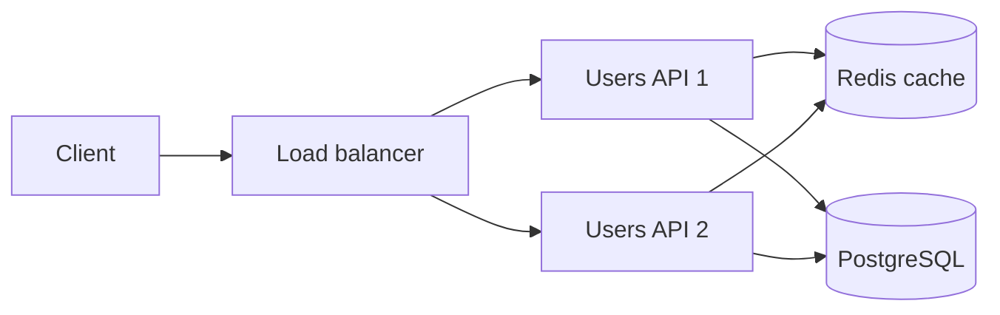
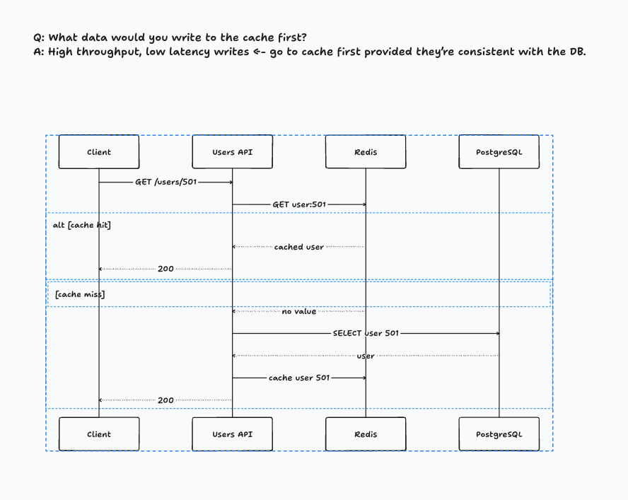

# Session 11: a cache for repeated reads, with PostgreSQL still the source of truth

**Continues:** [Session 10](session-10.md)

## The question we set out to answer

Session 9 added API capacity and session 10 made schema changes safe, but both API instances still
ask the same PostgreSQL database for every read. If `/users/501` is requested thousands of times
and changes only occasionally, the API repeats the same database read each time.

> **If many clients keep asking for the same user and that user has not changed, should every
> request have to read PostgreSQL again?**

That repeated work is the reason for a cache. Redis is not here because system-design diagrams
have one.



The important part of the diagram is not Redis. It is that PostgreSQL is still the authoritative
database:

```text
PostgreSQL = source of truth
Redis      = temporary copy for selected reads
```

## The words

| Term | Simple explanation |
|---|---|
| Cache | A faster temporary copy of data we expect to use again. |
| Cache hit | The requested value was already in the cache. |
| Cache miss | The value was not in the cache, so we needed the source of truth. |
| TTL | Time to live: how long a cached value may exist before it expires. |
| Stale data | A cached copy that is older than the current authoritative value. |
| Invalidation | Removing a cached value because the underlying data changed. |
| Cache-aside | The application checks the cache first and loads from the database on a miss. |

The filing-cabinet analogy: the cabinet is the official record (PostgreSQL), the copy on your desk
is quicker to reach (Redis). If they disagree, the cabinet wins.

## What we built

One operation is cached, with one declared staleness rule:

```text
cached operation: GET /users/{id}
cache key:        user:{id}
TTL:              CACHE_TTL_SECONDS
source of truth:  PostgreSQL
```

The code default for `CACHE_TTL_SECONDS` is 15 seconds. [`../docker-compose.yml`](../docker-compose.yml)
passes 300 unless the variable is set, so `CACHE_TTL_SECONDS=15 docker compose up -d api` runs with
15 without editing the file. Either number is a lab choice. In a real design the acceptable
staleness comes from the product requirement: a bank balance and a public profile would not share
one rule.

### The read path: cache-aside



`get_user` in [`../app/main.py`](../app/main.py) follows it step by step:

```text
1. build cache key
2. ask Redis
3. HIT? return it
4. MISS? ask PostgreSQL
5. cache the result with a TTL
6. return the result
```

An `X-Cache` response header makes the path visible:

| `X-Cache` | Meaning |
|---|---|
| `HIT` | Redis had the user. PostgreSQL was not asked. |
| `MISS` | Redis did not have it. PostgreSQL answered and a copy was cached. |
| `BYPASS` | Redis could not be reached. PostgreSQL answered and nothing was cached. |

A `404` is not cached, so a user created a moment later is visible on the next read.

### The write path: invalidate after commit

```text
PATCH /users/501
      ↓
update PostgreSQL
      ↓
commit succeeds
      ↓
delete user:501 from Redis
      ↓
next GET is a MISS
      ↓
reload fresh value from PostgreSQL
```

Every write (`POST`, `PUT`, `PATCH`, both `DELETE`s) ends with `_cache_invalidate`, and always
after the commit. Invalidating first would let a concurrent `GET` re-cache the old row before the
write lands.

The gap is real: if the commit succeeds and the invalidation fails, the old copy stays in Redis.
The API logs it and the TTL bounds how long it can be served.

### Redis is allowed to fail

```text
Redis unavailable
→ log cache error
→ read PostgreSQL
→ still answer the request
```

Four decisions keep a cache outage from becoming an API outage:

- Redis has 200 ms timeouts and no retries. A cache is only worth asking if asking costs less than
  the database read it saves.
- Redis is not in the API's `depends_on`, so the API starts without it.
- `/health/ready` does not check Redis. A cache outage makes reads slower, not wrong, so it is no
  reason to take an instance out of rotation.
- The Redis container keeps nothing on disk and evicts the least recently used key at 64 MB. It
  restarts empty and refills from PostgreSQL.

`GET /users/{id}` also borrows a database connection only on a miss. A hit that still held one of
the pool's connections would not relieve the limit we hit under load in session 7.1.

## Run it

The step-by-step commands and expected output are in
[`session-11-lab-steps.md`](session-11-lab-steps.md).

## What actually happened when we ran it

### 1. The HIT came from the other API instance

```text
200  X-Cache: MISS  X-Instance-ID: 3d346fbc9ec9
200  X-Cache: HIT   X-Instance-ID: 73d6b8006202
```

HAProxy sent the two reads to different replicas. One filled the cache and the other read from it,
because Redis is shared. A cache held in each API process's memory would have missed twice.

### 2. After a PATCH, Redis held nothing

```text
PATCH /users/501 {"name":"ABCDEFG"}   → 200
redis-cli get user:501                → (nil)
```

A write does not put the new value into Redis. It deletes the old one, and the next read refills
it: `MISS` with the new name, then `HIT`. Deleting the user did the same thing through the same
function.

### 3. Redis stopped, and the API kept answering

```text
docker compose stop redis
GET /users/501      → 200  X-Cache: BYPASS
GET /health/ready   → 200
PATCH /users/501    → 200
```

```text
api-2  | cache_read_failed key=user:501 error=network:ConnectionError fallback=postgres
```

We chose degraded performance over unnecessary unavailability when only the cache is down. After
`docker compose start redis` the first read was a `MISS` and the second a `HIT`.

### 4. A cache setting took the API down when a cache outage did not

Setting the TTL to `300s` in `docker-compose.yml` stopped both replicas at startup:

```text
ValueError: invalid literal for int() with base 10: '300s'
dependency failed to start: container system-design-done-differently-api-2 is unhealthy
```

The value is a number of seconds, so `300`. With no healthy API, the load balancer did not start
either. The API survives Redis being absent, but not its own configuration being wrong, and failing
at startup is better than caching with a TTL nobody intended.

### 5. Timing did not show the difference

On a laptop a `HIT` and a `MISS` both took about 10 ms. The header is the evidence that the path
changed. What the cache saves here is database work, and that shows up under load, not in one
`curl`.

## Invalidate or update?

The alternative to deleting on write is **write-through**: put the new value into Redis after the
commit. The next read is then a `HIT`, but two concurrent writes can finish in one order in
PostgreSQL and the other order in Redis, which leaves the older value cached until the TTL expires.
Deleting has no such ordering problem: whoever deletes last, the next read reloads what PostgreSQL
holds.

Write-through earns its place when a read almost always follows the write, when rebuilding the
value is expensive, or when a key is so hot that a miss would send many requests to the database at
once. For a cheap single-row read, deleting is the simpler default.

The whiteboard took the question one step further:

> **Q: What data would you write to the cache first?**
>
> A: High throughput, low latency writes go to the cache first, provided they are consistent with
> the DB.

That is a different design from ours. Writing to the cache first and to the database afterwards
means the cache briefly holds data PostgreSQL does not, so losing the cache can lose writes. Our
Redis keeps nothing on disk precisely because nothing lives only there. Cache-first writes need a
rule for how the two are brought back into agreement, and that is outside this session.

## What this does not solve

- A change made directly in PostgreSQL, outside the API, is not seen until the TTL expires.
- Many simultaneous misses for one key all read PostgreSQL (a cache stampede).
- `GET /users` is not cached. A list changes whenever any user does, which is a harder invalidation
  rule than one key per user.
- Caching does not always help: data that changes on every read, or is read once, gains nothing.

## What we can conclude

1. PostgreSQL owns the real user data. Redis keeps a temporary copy of selected reads.
2. A `HIT` avoids a database read. A `MISS` goes back to PostgreSQL.
3. The TTL limits how long a cached copy can live, including a copy we failed to invalidate.
4. Writes change PostgreSQL first and invalidate the cache after the commit.
5. Losing the cache costs performance, not availability or data.
6. The cache exists in this architecture because we identified repeated read work and declared how
   stale an answer may be, not because big systems use Redis.

## Next

A new product requirement: when a user account is created, send a welcome notification. Should
`POST /users` stay open for three seconds because sending it is slow? Caching helped repeated
reads. It does nothing for slow side effects that happen after a write.
