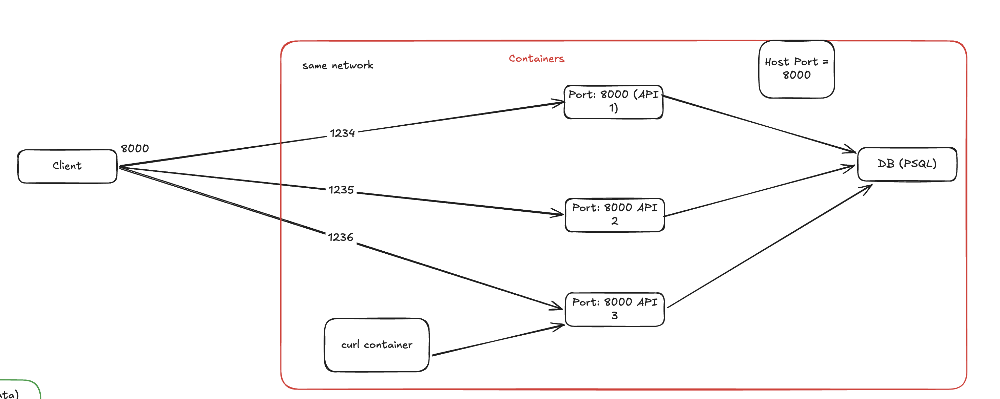

# Session 8.1: three API instances, one host port

**Continues:** [Session 8](session-8.md)  
**Date:** 2026-10-15

## Where this session started

Session 8 asked whether one API instance could be safely replaced before we add another, and left
the liveness and readiness hands-on open. This session went the other way round: we started three
API instances first to see what breaks when the current setup is simply multiplied.

That order is recorded honestly here. The readiness work from Session 8 is **still not done**, and
the results below make the gap more concrete, not less.

The question for this session:

> **If we run three copies of the API, how does a request reach one of them, and how do we know
> which one answered?**



## First attempt: `--scale api=3`

```bash
docker compose up -d --scale api=3
```

```text
✔ Container system-design-done-differently-api-1 Running
✔ Container system-design-done-differently-api-3 Created
✔ Container system-design-done-differently-api-2 Created
Error response from daemon: failed to set up container networking: driver failed programming
external connectivity on endpoint system-design-done-differently-api-2 (...):
Bind for 0.0.0.0:8000 failed: port is already allocated
```

The Compose file published the API as `"8000:8000"`, read as **host port : container port**:

```text
request → localhost:8000 (host port, on your machine) → 8000 (container port, inside one container)
```

Each container has its own network namespace, so all three replicas can listen on container port
8000 without conflict. The host has only one port 8000, and a port can have only one listener.
The first replica took it, and the other two could be created but not started.

Changing the number does not help. We tried `"1111:8000"` and got the same error with
`Bind for 0.0.0.0:1111 failed`. The fixed host port is the problem, not its value. Only one
replica came up, and it answered on the new port:

```text
$ curl -i http://localhost:1111/users/123
HTTP/1.1 200 OK
x-instance-id: 4d3af54c711e
{"id":123,"name":"john","email":"john@example.com"}
```

| `ports:` entry | Meaning | With `--scale api=3` |
|---|---|---|
| `"8000:8000"` | host 8000 → container 8000 | first replica starts, the rest fail to bind |
| `"1111:8000"` | host 1111 → container 8000 | same failure on 1111 |
| `"8000"` | container 8000, Docker picks a free host port | all three start, each on its own random host port |

## Container port only: three replicas, three addresses

With `"8000"` all three replicas started:

```text
NAMES                                  PORTS                                           CONTAINER ID
system-design-done-differently-api-3   0.0.0.0:61893->8000/tcp, [::]:61893->8000/tcp   166f06dfb055
system-design-done-differently-api-2   0.0.0.0:61894->8000/tcp, [::]:61894->8000/tcp   9da6c367fb45
system-design-done-differently-api-1   0.0.0.0:61895->8000/tcp, [::]:61895->8000/tcp   1bcacb5fdd4f
```

Every replica answered `200` on its own port, but `localhost:8000` now refused connections because
nothing was published there:

```text
$ curl -i http://localhost:8000/users/123
curl: (7) Failed to connect to localhost port 8000 after 0 ms: Couldn't connect to server
```

So the replicas run, but a client now has three addresses to pick from. Those addresses also change
every time a container is recreated: the same replicas were on 60293–60295, then 61170/61262/61263,
then 61893–61895 within the same evening. Nothing gives the client one stable entry point and
spreads requests across the replicas. Providing that is the job of a load balancer.

The base [`docker-compose.yml`](../docker-compose.yml) keeps `"8000:8000"` so the single-instance
commands in the rest of the repo still work. The multi-replica setup lives in an override file,
[`docker-compose.scale.yml`](../docker-compose.scale.yml).

## Which instance answered? `X-Instance-ID`

With three replicas, a `200` no longer tells us which process served the request. Every response
now carries a header naming the instance:

```python
# Which replica answered. In Docker the hostname is the short container ID, so
# each `--scale api=N` replica reports a different value with no extra config.
INSTANCE_ID = os.environ.get("INSTANCE_ID") or socket.gethostname()


@app.middleware("http")
async def add_instance_id(request: Request, call_next):
    response = await call_next(request)
    response.headers["X-Instance-ID"] = INSTANCE_ID
    return response
```

Two choices worth noting:

- **A header, not a body field.** The instance describes the server, not the user, so the `User`
  response shape stays the same. Because it's middleware, the header is also on error responses,
  so even a 404 says who sent it.
- **The hostname by default.** Docker sets the container hostname to the short container ID, so
  the header matches the `CONTAINER ID` column in `docker ps` with no configuration. In the `1111`
  run above, `4d3af54c711e` was exactly that replica's ID.

[`tests/test_users.py`](../tests/test_users.py) checks that the header is present on a 404.

## A detour: getting a client inside the network

We first tried to send requests from inside one of the API containers.

| What we ran | What happened | Why |
|---|---|---|
| `docker exec -it 166f06dfb055 -- sh` | `exec: "--": executable file not found` | `docker exec` does not take `--`; it treated `--` as the command to run. Use `docker exec -it <id> sh` |
| `curl -h` inside the container | `curl: command not found` | `python:3.13-slim` keeps tools like curl out of the image on purpose |
| `apt install curl` | `Unable to locate package curl` | slim Debian images ship with empty package lists; `apt-get update` would be needed first |
| `sudo apt install curl` | `sudo: not found` | the container already runs as root, so there is no `sudo` to need |
| `docker ps --format "{{.Container}}"` | `can't evaluate field Container` | the field is `{{.ID}}` |

Even if installing curl had worked, it would be the wrong move, and Session 8 explains why:
anything installed into a running replica disappears when that container is replaced, and it makes
one replica different from the others. A disposable instance shouldn't need hand edits. The client
should be a separate container.

## Is there a built-in load balancer?

**Not in Compose for traffic from the host.** Docker gives us two related things:

1. **DNS round-robin inside the network.** On the Compose network, Docker's embedded DNS server
   (`127.0.0.11`) answers the service name `api` with the IPs of **all** replicas, in shuffled
   order. A client inside the network gets a crude form of distribution without any extra setup.
   Your Mac's resolver does not know the name `api`, and on Docker Desktop the container IPs live
   inside a Linux VM, so this only works from a container on that network.
2. **Swarm mode's routing mesh.** `docker stack deploy` keeps `"8000:8000"` and spreads requests
   across replicas itself. It is a different deployment model, though: it ignores `build:`,
   `depends_on` and `condition: service_healthy`.

Neither is what we'll use next. A small proxy (nginx, HAProxy, Traefik) in front of the replicas
makes the load balancer a visible part of the system that we can configure, health-check through,
and watch become a single point of failure.

## Distributing requests with Docker DNS

`curlimages/curl` is a small image with curl in it. It is there only to be a client **on the same
network** as the replicas. That's the "curl container" box in the diagram.

```bash
docker run --rm --network system-design-done-differently_default curlimages/curl sh -c '
ok=0; fail=0
for i in $(seq 1 100); do
  out=$(curl -s -o /dev/null --connect-timeout 2 --max-time 5 -w "%{http_code} %header{x-instance-id}" http://api:8000/users/123)
  rc=$?
  case "$out" in 2*) ok=$((ok+1)); tag=OK ;; *) fail=$((fail+1)); tag="FAIL rc=$rc" ;; esac
  echo "$(date +%T) #$i $out $tag"
  sleep 1
done
echo "done: $ok ok, $fail failed"'
```

We stopped the run after 16 requests, all of them successful:

```text
19:44:21 #1 200 166f06dfb055 OK
19:44:22 #2 200 1bcacb5fdd4f OK
19:44:23 #3 200 166f06dfb055 OK
19:44:24 #4 200 1bcacb5fdd4f OK
19:44:25 #5 200 9da6c367fb45 OK
19:44:26 #6 200 9da6c367fb45 OK
...
19:44:36 #16 200 166f06dfb055 OK
```

| Replica | Container ID | Requests (of 16) |
|---|---|---:|
| api-3 | `166f06dfb055` | 6 |
| api-2 | `9da6c367fb45` | 6 |
| api-1 | `1bcacb5fdd4f` | 4 |

All three replicas got traffic, but it **was not a rotation**. The same replica answered twice in a
row three times (#5–#6, #8–#9, #12–#13). Each curl process resolves `api` again, gets the IPs
in a shuffled order and connects to the first one. That is shuffling, not balancing: there is no
policy, no awareness of load, and no health check.

## Stopping an instance mid-run

The experiment we set out to run was to keep the loop going, stop one or two replicas from a
second terminal, and look for failed requests:

```bash
docker stop system-design-done-differently-api-2
docker stop system-design-done-differently-api-3      # down to one instance
docker start system-design-done-differently-api-2 system-design-done-differently-api-3
```

We stopped and restarted replicas during the session, but the client output from those runs was
not captured, so **no failure count is recorded here**. Expect very few failures, for two reasons
that have nothing to do with our design:

- **Docker DNS stops returning a replica once it has stopped**, so new requests do not go to it.
- **curl tries the next address on its own.** If one IP refuses the connection, it moves to the next
  one that DNS returned. The failover is happening in the client.

A failure needs a request that is already in flight when its replica dies. `GET /users/123` is fast,
so that window is tiny. `docker kill` (no graceful shutdown) makes it more likely than `docker stop`.

## Timeouts do not save requests

The loop uses `--connect-timeout 2 --max-time 5`. A timeout does **not** stop a request from being
dropped. It only limits how long the client waits before it gives up, and a timed-out request is
a failed request (`000 FAIL rc=28`).

| Flag | Gives up when | Typical cause |
|---|---|---|
| `--connect-timeout 2` | the TCP connection isn't set up within 2 s | instance unreachable but not refusing, for example frozen |
| `--max-time 5` | the whole request takes longer than 5 s | connected, but the response never arrives, for example killed mid-request |

What actually keeps a user from seeing a failure is routing away from dead instances (DNS here, a
health-checked load balancer later) and **retries**:

```bash
curl ... --retry 3 --retry-connrefused --retry-delay 0 --retry-max-time 10 ...
```

`--retry-connrefused` matters because curl does not retry a refused connection by default.

**Retries are only safe for idempotent requests.** Retrying `GET /users/123` is harmless. A
`POST /users` that timed out may already have succeeded on the server. Retrying it returns
`400 user 123 already exists`, an error for a write that actually worked. Load balancers usually
retry connection failures, but not timeouts on non-idempotent methods, for this reason.

> Timeouts decide how quickly you notice a failure. Routing and retries decide whether the user
> ever sees it.

## What we can conclude

1. A published host port belongs to exactly one container. Scaling a service with a fixed host
   port fails at the second replica, whatever the port number.
2. Publishing only the container port lets the replicas run, but it leaves clients with several
   addresses that change whenever a container is recreated. There is no single entry point.
3. Docker's DNS gives clients *inside* the network every replica in shuffled order. That is not a
   load balancer: there is no entry point from outside, no distribution policy and no health check.
4. `X-Instance-ID` lets us see which instance served every response, errors included.
5. Timeouts limit waiting. Routing away from dead instances and retrying idempotent requests are
   what prevent user-visible failures.
6. Session 8's readiness gap is now concrete. Nothing in this path would stop sending requests to a
   replica that is running but can't reach PostgreSQL.

## Reproduce it

```bash
# three replicas, each on a random host port
docker compose -f docker-compose.yml -f docker-compose.scale.yml up -d --build --scale api=3
docker ps --format "table {{.Names}}\t{{.Ports}}\t{{.ID}}"

# one replica directly from the Mac (use a port from the table above)
curl -i http://localhost:<host-port>/users/123

# all replicas through Docker DNS: run the curl container loop above,
# then stop or kill replicas from a second terminal

# back to a single instance on localhost:8000
docker compose up -d --scale api=1
```

The loop asks for `/users/123`, so create that user first if the database is empty (see
[`../app/README.md`](../app/README.md)).

## Next

- **Capture the stop and kill experiment.** Rerun the loop and record ok/failed counts for
  `docker stop` against `docker kill`, with and without `--retry`.
- **Finish Session 8's hands-on.** Liveness and readiness endpoints and an API health check in
  Compose. A load balancer needs these to know which replicas should get traffic.
- **Put a load balancer in front.** Have a proxy own `localhost:8000` and forward to `api:8000`.
  Check whether it notices replicas added after it starts (nginx resolves the name once at startup
  unless told otherwise) and whether it stops routing to an instance that is not ready.

## Open questions

- Each replica opens its own connection pool (`max_size=4` by default, the limit we hit in
  [Session 7.1](session-7.1-measuring-under-load.md)). Three replicas mean up to 12 connections to
  the same PostgreSQL. Does adding API instances raise throughput, or move the bottleneck to the
  database?
- When a replica is stopped, should in-flight requests be allowed to finish first? What does
  `docker stop`'s grace period give us, and does uvicorn use it?
- Where should retries live: the client, the load balancer, or both? What happens when both retry
  the same failure?
