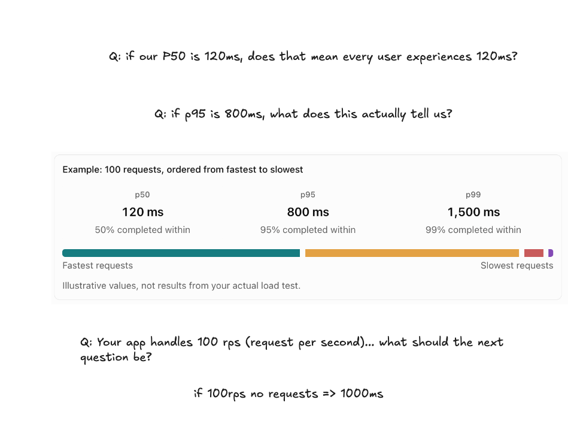
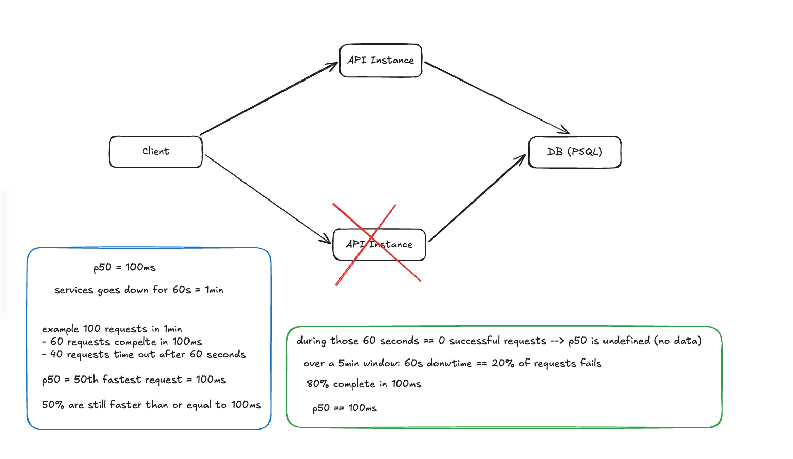
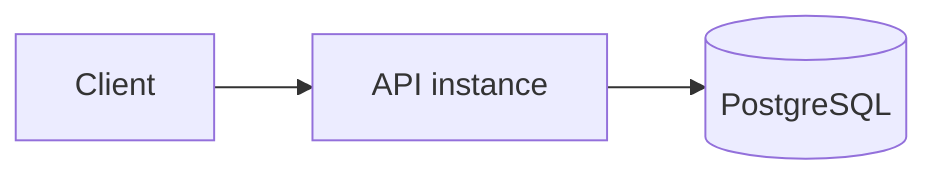

# Session 8: before we add another API, can we safely replace one?

**Planned duration:** 60 minutes  
**Planned hands-on:** 25–30 minutes (not reached during this first pass)

## The observation that motivated this

Session 7 put one API instance under pressure and gave us a reason to consider more capacity.
The obvious next drawing has two API instances, but drawing a second copy skips an important
question:

> **Before you duplicate a server, make sure a server is disposable.**

The question for this session is therefore:

> **If this API instance disappears and another one starts, what must remain true?**

Keep the sequence visible:

```text
Session 7
one instance has a measurable limit
        ↓
Session 8
make one instance replaceable
        ↓
Session 9
run more than one instance
```

This is not Docker 101 and it is not a container-security session. We have used Docker for
several sessions already. The container is useful here because it gives us a concrete process to
remove and recreate while we inspect what survives.

## Where the session actually went

We intended to move from the capacity result into replacement and health checks. Before doing
that, we recapped the Session 7 numbers. The recap produced several scenarios and a longer
discussion about what percentiles do and do not prove, so we did not yet implement the replacement
drill or health endpoints.

That discussion was still part of the design. It exposed a missing distinction:

> A fast latency percentile does not prove that an instance is available, and an available
> process is not necessarily ready to receive traffic.

This write-up records the reasoning reached so far and leaves the unperformed hands-on work
explicit rather than describing it as complete.

## Recap: read the percentile as a position, not as every user's latency

Suppose we order 100 completed requests from fastest to slowest:

| Measurement | Example value | What it tells us |
|---|---:|---|
| p50 | 120 ms | at least 50 requests completed in 120 ms or less |
| p95 | 800 ms | at least 95 requests completed in 800 ms or less; up to 5 were slower |
| p99 | 1,500 ms | at least 99 requests completed in 1,500 ms or less; up to 1 was slower |

So a p50 of 120 ms does **not** mean every user waited 120 ms. It tells us where the middle
observation lies after sorting the measured latencies. Likewise, p95 is useful precisely because
it makes us look beyond the typical request and toward the slow tail.



### RPS arithmetic and the concurrency trap

The next question after “the service handles 100 requests per second” is not automatically “how
many servers do we need?” Start with the unit:

```text
100 requests / 1 second = 100 RPS
100 RPS × 60 seconds = 6,000 requests in one minute
```

That rate does not give us per-request latency. Two systems can both report 100 RPS:

| Scenario | How the work completes | Approximate latency | Approximate in flight |
|---|---|---:|---:|
| A | one request completes every 10 ms | 10 ms | 1 |
| B | 100 requests overlap and all complete after 1 s | 1,000 ms | 100 |

Under a stable flow, this relationship is a useful reasonableness check:

```text
average requests in flight ≈ throughput × average response time

100 requests/s × 0.1 s ≈ 10 in flight
100 requests/s × 1.0 s ≈ 100 in flight
```

This is an application of Little's Law. It uses averages over a stable window, not p50 or p95,
and it does not identify the bottleneck. It simply shows why throughput, latency, and concurrency
must be read together.

We then need to ask what happened to the observed requests:

- What were p50, p95, and p99 latency?
- What percentage succeeded, failed, or timed out?
- For how long was this measured, and what was the traffic pattern during that window?
- Which resource reached its limit?
- What target or service objective are we comparing the result with?

RPS is a rate. Its exact numerator also matters: a client-side tool may count attempts while a
server metric may count requests received or completed. It does not, by itself, tell us how long
individual requests took, how many succeeded, or whether some attempts were dropped before the
server observed them.

## The failure scenario that connected the recap to Session 8

We then considered an instance that normally answers in 100 ms but disappears for 60 seconds.
For a deliberately simple set of 100 attempts:

```text
60 requests complete in 100 ms
40 requests time out after 60 s
```

The 50th observation is still one of the 100 ms requests, so p50 can still be 100 ms even though
40% of attempts failed. The median has not become mathematically wrong; it is answering a much
narrower question than “was the service usable?”

The higher percentiles reveal more only if the timed-out attempts are included in the latency
population. Our load tool does include them, so in this example its p95 would land among the
60-second timeouts. A production dashboard may instead calculate latency from successful
requests only. During a minute with zero successful requests, that dashboard has no successful
latency samples: p50 is undefined or absent, not evidence of a fast service.

With traffic arriving evenly and every request outside the outage succeeding, a five-minute
window can flatten one minute of downtime into a healthy-looking median:

```text
availability: 80% succeeded, 20% failed
success latency: p50 = 100 ms
```

The exact request count depends on the arrival rate; the percentages are the important part.
This is why every percentile must come with its population and time window, and why latency must
be read beside an error or success rate.



## Start from the system we already have



Now imagine deleting the API container and starting another copy.

**What would we be worried about losing?**

- user data;
- configuration needed to recreate the process;
- the ability to connect to PostgreSQL; and
- the ability to tell whether the new process is actually usable.

The first question has an answer from Session 3: durable business data lives in PostgreSQL, not
in the API process. The database volume outlives the API container, and
[`../scripts/prove-persistence.sh`](../scripts/prove-persistence.sh) already restarts the API and
checks that a stored user remains.

That gives us one necessary property:

> The API process does not own durable business data, so replacing the process does not erase a
> user.

It is necessary, but it is not sufficient. A replacement could preserve the data and still be
misconfigured, unable to reach PostgreSQL, stuck during startup, or accepting traffic before it
can serve a real request.

## Three properties we must not collapse into one

| Property | Question | Evidence we have today |
|---|---|---|
| Durability | Did business data survive replacement? | yes: PostgreSQL is the source of truth and the persistence script exercises an API restart |
| Liveness | Is the API process running rather than dead or stuck? | not yet expressed as an API health contract |
| Readiness | Should this particular instance receive traffic now? | not yet expressed or tested |

A TCP connection or a running container can suggest liveness, but neither proves readiness. For
this service, readiness has to account for the dependency on PostgreSQL because every current
endpoint uses it. Conversely, a temporary database failure should not necessarily mean the API
process must be killed; liveness and readiness may change independently.

The distinction matters before Session 9. Once something distributes traffic across instances,
it needs a small, reliable signal for whether each instance is eligible to receive that traffic.
Without that signal, a second instance can increase capacity on paper while sending users to a
process that cannot serve them.

## The current replacement contract

From the code and Compose configuration already in the repository, a replacement instance needs:

- the same application image;
- `DATABASE_URL`, assembled from the Compose environment;
- network access and valid credentials for PostgreSQL;
- PostgreSQL accepting connections during startup; and
- the shared schema and data to remain outside the API container.

The current lifespan function opens the connection pool, waits up to 30 seconds, and creates the
table before startup completes. Compose also waits for the database container's health check
before starting the API. Those choices help startup, but there is still no API health endpoint
and no Compose health check for the API itself.

## What we can conclude now

1. Session 7's capacity numbers do not by themselves justify adding an instance; they need a
   latency objective, success rate, time window, and identified bottleneck.
2. p50 can remain fast during serious failure. Percentiles describe a distribution, not service
   availability.
3. PostgreSQL owning durable user data makes the API *capable* of being disposable.
4. We have not yet proved the complete replacement property, because we cannot yet ask the API
   separately whether it is alive and ready for traffic.

## Hands-on work still to do

The next continuation of Session 8 should turn these claims into executable checks:

1. Define a liveness endpoint that proves the process can answer a request without depending
   on PostgreSQL.
2. Define a readiness endpoint that checks the dependencies required to serve the API's real
   traffic, including PostgreSQL, and returns a non-success status when the instance should be
   removed from rotation.
3. Add an API health check to Compose so container state reflects that contract.
4. Seed a user, replace only the API container, wait for readiness, and retrieve the same user.
5. Stop PostgreSQL and observe the difference between “process is alive” and “instance is not
   ready.” Start it again and verify that readiness recovers.

The definition of done is not “the new container started.” It is:

```text
same durable user
+ same required configuration
+ dependency reachable
+ readiness says traffic is safe
= replacement instance can serve the request
```

Only after that proof should Session 9 put more than one API instance behind a traffic-distribution
mechanism.

## Open questions for the continuation

- Should readiness perform `SELECT 1`, borrow a pool connection, or exercise a real application
  query? What useful failure can each option miss?
- Should startup fail when PostgreSQL is unavailable, or should the process stay alive and report
  not-ready until the dependency returns?
- How quickly should a transient dependency failure change readiness, and how do we avoid health
  checks creating their own load?
- Which configuration is required for every replacement, and how will a missing or invalid value
  fail visibly?
- When an instance stops receiving traffic, how should in-flight requests be allowed to finish
  before the process exits?
