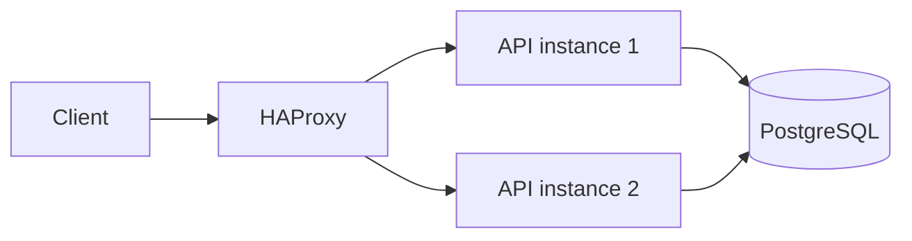

# Session 9: two API instances behind a load balancer

**Continues:** [Session 8](session-8.md), [Session 8.1](session-8.1.md)

## The question we set out to answer

Session 8 established the conditions for replacing an API process without losing its data.
Session 8.1 showed that running several API replicas leaves the client with a routing problem:
which instance should receive a request, and what address should the client call?

> **If two healthy API instances serve the same service, who chooses which one receives the
> client's request?**

The client needs one stable address. The API replicas need to share the same durable state. A load
balancer sits between them and chooses a backend for each request.



## The request path now has one entry point

Compose starts two replicas of the `api` service and one HAProxy container. HAProxy publishes host
port `8000`; the API replicas listen on container port `8000` inside the Compose network. The
client still calls `http://localhost:8000` and does not need to know which replica receives the
request.

```text
client → localhost:8000 → HAProxy → one ready API instance → PostgreSQL
```

The `docker ps` output from the run shows the port distinction:

| Container | Ports shown by Docker | Meaning |
|---|---|---|
| `load-balancer` | `0.0.0.0:8000->8000/tcp` | host port 8000 maps to container port 8000 |
| `api` replicas | `8000/tcp` | container port only; no host port is published |

That leaves one public address while allowing both API containers to use the same internal port.

## HAProxy chooses a ready backend

The backend in [`../haproxy.cfg`](../haproxy.cfg) uses `roundrobin` and checks each API's
`/health/ready` endpoint. An API instance that cannot reach PostgreSQL returns `503`; HAProxy
then marks it unavailable for new traffic until it passes the check again.

The liveness endpoint remains separate: `/health/live` answers whether the API process can serve
HTTP without querying PostgreSQL. This lets the process remain alive through a database outage
while readiness changes independently.

## Make the routing choice visible

Every API response carries `X-Instance-ID`. In Docker, the default value is the container
hostname, so the header identifies the replica that answered without changing the user response
body.

Use one URL repeatedly and print the status and instance ID for each response:

```bash
for i in $(seq 1 10); do
  printf 'Request %02d: ' "$i"
  curl -sS -D - -o /dev/null http://localhost:8000/health/live |
    awk '
      /^HTTP/ { status = $2 }
      tolower($1) == "x-instance-id:" { instance = $2 }
      END {
        gsub(/\r/, "", instance)
        printf "HTTP %s | instance %s\n", status, instance
      }'
done
```

With both backends healthy, repeated requests should show both instance IDs. The configured
round-robin policy rotates requests across available backends; it does not promise a particular
split for every short sample.

## What the container listing established

The shown `docker ps` output had HAProxy publishing host port `8000`, while the API containers
showed only their internal `8000/tcp` port. The API rows shown were healthy. This confirms the
container layout and the distinction between the public host port and the API container port.

The container listing alone does not show which API handled a request. `X-Instance-ID` provides
that evidence. The routing loop above and a one-instance failure drill are the checks to capture
next; no traffic counts or failover results are claimed here.

## Reproduce the setup and observe routing

Start exactly two API replicas, even if a previous run used the three-replica override:

```bash
docker compose up -d --build --scale api=2
docker compose ps
```

Then run the routing loop above. To check that the API replicas share data, create a user with an
ID not already in the database:

```bash
curl -i -X POST http://localhost:8000/users \
  -H 'content-type: application/json' \
  -d '{"id":901,"name":"session nine","email":"session-nine@example.com"}'
```

## Stop one API instance

Select one running API container by ID and stop it. `docker compose stop api` would stop every
replica, so this targets only one:

```bash
API_TO_STOP="$(docker compose ps -q api | head -n 1)"
printf 'Stopping API container %s\n' "$API_TO_STOP"
docker stop "$API_TO_STOP"
```

Wait about 10–15 seconds for HAProxy to refresh Docker DNS and mark the stopped backend
unavailable. Then repeat the routing loop and read the seeded user:

```bash
curl -i http://localhost:8000/users/901
```

The request should continue through `localhost:8000` and show the remaining API instance ID. The
user row should remain because PostgreSQL, not the API container, owns the data. A request during
the health-check transition can fail briefly.

Restart the API container and wait for it to become healthy and rejoin the backend pool:

```bash
docker start "$API_TO_STOP"
```

After about 10–15 seconds, run the routing loop again and look for both instance IDs.

## What we can conclude

1. The client has one stable address even though two API processes can serve the request.
2. The API replicas share PostgreSQL, so removing one API process does not remove the user data.
3. Readiness gives HAProxy a signal for whether an API replica should receive new requests.
4. We scaled the API tier, but HAProxy and PostgreSQL are each still a single instance.
5. More API replicas can increase the number of possible PostgreSQL connections because each
   process owns a connection pool.

Two replicas can add capacity and provide an alternate API process, but those are separate
calculations. If one instance can safely serve `C` requests per second, `2C` is only a simplified
normal-operation estimate. If one instance fails, the remaining capacity is about `C`, before
accounting for shared database limits. Use the measured capacity from [Session 7.1](session-7.1-measuring-under-load.md)
instead of treating replica count as a guarantee.

## Next

Investigate the shared database constraint. Measure how the API replica count affects possible
database connections, then consider safe schema evolution while more than one application version
may be running.
